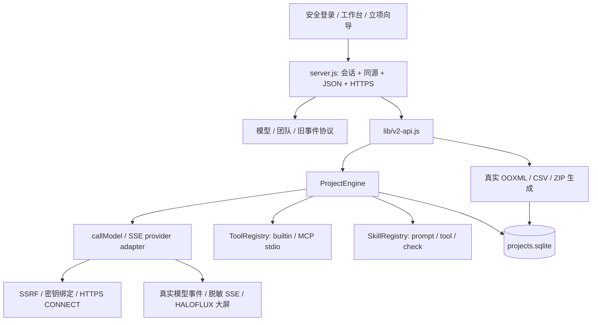

# AIJAVAIS V2 — 实际架构

> **C1（2026-11-11）布局**：规划器只有一套，在 `lib/planner/`——`rules.js`（规则向导，原 `public/project-intake/engine.js`，规则兜底）、`universal-team.js`、`catalog.v1.json`、`ai-draft.js`（AI 草案增强，原 `lib/intake-draft.js`）、`universal.js` + `universal-snapshot.js`（一句话通用工作流，原 `lib/universal-workflow.js`、`lib/workbench-r53.js`）、`index.js`（`createPlanner` 统一入口，`/api/v2/intake/plan` 走 `rulePlan`）。工作台事件契约在 `lib/work-contract.js`。浏览器需要的同一份文件由 `server.js` 的 `SHARED_ASSETS` 按原网址精确映射（同样的登录门禁），服务端不再 `require` `public/`。所有页面共用顶栏 `public/topbar.js`，任务汇总接口 `GET /api/v2/tasks` 仅管理员可用。relay 代码冻结在 `tools/relay/`，产品代码不得引用。

## 范围

Node 24 单进程应用，无生产 npm 依赖。保留原安全分支的所有模块与事件协议，在管理员认证边界后增加 V2 API。原 `main` 与两个来源分支未经修改。V2 是可运行的有限工作流系统，不是无限自主代理或多租户平台。



## 两层持久化

旧认证/配置保持兼容：`config.json`、`models.json`、`credentials.json`、`teams.json`、`auth.json`、`sessions.json`、`audit.log`、旧 `tasks.json`。凭据不进入公开模型视图；文件权限 0600。V2 不无损恢复旧内存 MessageBus/ArtifactStore，旧 `/api/run` 历史继续按原语义读取。

新增 `projects.sqlite`（schema v4；旧库启动时先 `VACUUM INTO` 生成 0600 备份再前向迁移）开启 foreign_keys、WAL、synchronous FULL、busy timeout，使用参数化 SQL：

| 表 | 实际用途 |
|---|---|
| schema_migrations | 迁移版本、应用时间和描述 |
| projects | ID、版本、所有者、创建/更新时间及规范化 JSON 文档 |
| runs | 项目 FK、状态、审批/目标/项目快照、时间、累计预算与用量 |
| steps | run+step 联合主键、顺序、角色、输入输出、检查、工具证据 |
| events | 单调 seq、run FK、发生时间和事件 JSON |
| messages | 发送/接收岗位、轮次、交接正文、消费/失败状态 |
| artifacts | run FK、MIME、SHA-256、元数据、真实内容 BLOB |
| usage_ledger | 调用用量、真实/部分/估算/未知来源、价格及保守费用 |
| settings | 版本化 Skills 完整快照；MCP 远程连接、停用列表与访问令牌（令牌从不返回给前端） |
| model_requests | （v4）owner/kind/requestId永久唯一键、参数摘要、派发/结算状态、唯一system_usage外键；不存提示词/凭据 |
| system_usage | （v3）项目运行以外的模型调用（连接测试、AI团队草案）用量；无价表的远程费用记为 null（未知） |
| project_files | （v2）项目资料原始字节、SHA-256、提取出的文字与提取状态；随项目级联删除 |

`projects.sqlite.lock` 阻止第二应用实例打开同一数据目录；死 PID 恢复有独立 recovery 锁。恢复时将未结束运行和步骤标为 interrupted，并把遗留费用预留转为未知账单记录。没有自动重放。在线备份工具用只读 SQLite 连接，避免实例恢复副作用。

## 执行机制

项目创建规范化 name/description/standards/quantification/roles/steps；岗位可增删，职责、边界和标准写入每步 system prompt。步骤可以复用同一模型；角色通信由持久 messages 记录，前序实际输出完整进入后续 prompt，不仅在画面上闪动。

运行前：检查连接通过实际试连、未停用、声明能力满足；所需工具和 Skills 已注册；精确工具权限已批准；非本机免费模型要每次批准及价表。`readyForAutomatedExecution` 等客户端字段不是授权依据。

运行状态主链为 `running → review_required → approved`。质量失败、调用错误、取消分别进入失败/取消状态；重启会进入 interrupted。人工返工需要反馈、新的预算批准并遵守最大轮次；重新执行整个有限步骤序列，保留旧轮次证据。审核通过是人工操作，不把模型“说通过”当正式批准。

每步：交接消息 → 显式工具/Skill before → 预算预留 → 真实模型适配器 → 结算 → 检查/Skill after → 持久成果/消息消费。取消传递 AbortSignal 至网络和工具，等待结算后释放执行标志；执行尚未收尾不允许级联删除。

费用以 USD 用户价格表计算，并非供应商账单核对。用保守输入字节数+输出上限预留 Token 和金额；每步串行预留，限制并发。完整厂商 usage、部分 usage、估算、未知分别记账。可能的历史费用不能被“取消”抹去。

## API 与文件

- `/healthz`：无数据、公开进程健康，可供平台 HTTP 内部探针；不建立会话。
- `/api/v2/health`：管理员可看 schema/activeRuns。
- `/api/v2/projects` 和 `/:id`：创建、列表、读取、版本校验更新、删除。
- `/:id/validate`、`/:id/runs`：检查和启动；`/api/v2/runs/:id` 返回步骤、消息、事件、成果及账本。
- `/api/v2/runs/:id/cancel|review|export`：取消、人工批准/返工、真实二进制生成；artifacts 下载验证 run 归属。
- `/api/v2/tools`、`/discover`、`/call`：列举、受信配置发现、明确授权调用；不接受 HTTP 注册启动命令。
- `/api/v2/skills`：版本化配方持久化；`/intake/plan` 与 `/intake/projects` 使用服务端注册状态重算立项草案。

DOCX/XLSX/PPTX 是实际 ZIP/CRC32/OOXML，不是改后缀文本。Code ZIP 只打包明确提供的文件；不会执行模型生成代码或替用户证明其正确。导出 bytes、MIME、SHA256 和审核状态进入 SQLite，重启可原样下载。

## 安全边界与实际限制

单管理员和只读观看会话，不是企业多用户 RBAC 接线。大屏由既有服务端事件驱动；模拟、外部上报和真实模型事件保持不同来源。V2 项目内容只给管理员，单独 SSE 仅元数据。

严格 DNS 模式固定校验过的 IP；平台代理使用 TLS CONNECT 且保持证书验证、不直连回退。显式 `AIJ_PROXY_DNS=delegate` 仅用于官方或显式白名单公共主机，代理必须负责 DNS/私网阻断；应用不能证明代理实际连接 IP。

MCP 支持 stdio（管理员配置文件）与远程 Streamable HTTP（网页添加，静态令牌，暂不支持 OAuth），协议方法为 initialize、tools/list、tools/call。管理员配置进程具有服务账户 OS 权限；`shell:false` 不是沙箱。工具返回内容是未受信数据，不能更改预算/权限。共享 MCP 子进程的取消可能使同服务器并发调用失败，下次重连。尚无 MCP OAuth、模型自主工具选择、强隔离的任意代码运行器（现有受控 JavaScript 执行默认关闭、非强沙箱）、专业工程校核；第三方生产 MCP 未验收。

## 2026-11 新增模块（Claude Code 接力）

| 模块 | 作用 | 外部程序 |
|---|---|---|
| `lib/file-extract.js` | 上传文件类型核验与文字提取：DOCX/XLSX/PPTX 用自写有界 ZIP 读取（`zlib`、CRC32、压缩比上限）+ 只取文字的 XML 分词（拒绝 DTD）；文本需 UTF-8；PDF 调用 `pdftotext` | poppler（可选） |
| `lib/data-analysis.js` | CSV 解析、确定性统计/分组/排序/筛选、SVG 图表；不计算公式、不执行表达式 | 无 |
| `lib/office-render.js` | Office→PDF、PDF→PNG 与空白页检测；私有临时目录、一次性 LibreOffice 配置、无 shell、超时杀进程组 | LibreOffice、poppler（可选） |
| `lib/mcp-http.js` | MCP Streamable HTTP 客户端，经 `pinnedFetch` 出站（同模型接口 SSRF/TLS 规则），静态令牌 | 无 |
| `lib/capabilities.js` | 能力目录（内置/MCP/Skill/外部服务/未实现）、状态实时计算、立项工具 ID 映射、系统就绪检查 | 检测可选程序 |

内置工具（均需每次运行精确授权）：`docx/xlsx/pptx_generation`、`file_read`、`project_file_read`、`data_analysis`、`chart_generation`、`document_convert`、`document_render`、`builtin:text-stats`、`builtin:json-validate`。

**依赖决策**：继续保持**零 npm 生产依赖**。PDF 文字、Office 转换与渲染使用服务器上的可选系统程序（poppler、LibreOffice），运行时探测；缺失时能力中心显示“需要配置”，相关工具返回 `tool_unavailable`，不伪装成功。Docker 镜像内置 poppler，LibreOffice 体积较大需按需安装。`claude/v2-cloud-snapshot` 中依赖 npm 包的实现未合并，相应能力以零依赖方式重写。

**项目资料进入模型的方式**：运行开始时快照资料文件 ID 与 SHA-256；每步按 `materials.maxChars` 预算把提取文字作为“不可信数据”放入 prompt，截断会明确告知模型并记录实际字数；无法读取的文件会告知模型“存在但无法读取”。步骤可设 `useMaterials:false`。

**MCP 安全边界**：网页只能添加远程 HTTP MCP（不在服务器运行程序）；本机 stdio MCP 只能由管理员写入 `AIJ_MCP_SERVERS_FILE`。停用的服务器工具被移出注册表并拒绝调用。远程服务的地址校验在添加时（语法）和每次请求时（DNS/IP）各做一次。

**工具风险与授权（2026-11 GPT 审核 P1-01）**：每个工具有风险级别 `read` / `internal_write` / `exec` / `external`（全部 MCP 工具）。手动调用中，只读工具需在请求中显式授权；其他工具需要服务端签发的一次性确认（`/api/v2/tools/call/prepare`，绑定工具与参数哈希，120 秒）。项目运行中，`external` 与 `exec` 工具除了 `allowedTools` 外还需 `approveExternalTools: true`，并记入运行快照。MCP 的 readOnly 等标注只作为未经验证的提示。

**交接**：默认后一步接收前一步完整输出；步骤可设 `handoff: 'all'` 接收本轮全部前序成果（按岗位与步骤标注），仍受 200k 字符输入上限约束。

## 动态团队草案（工作单元2）

`lib/budget.js`是ProjectEngine与IntakeDraftService共用的模型授权/预留/结算策略，持久化由各调用方负责。`POST /api/v2/intake/ai-draft`只调用一次已测模型，严格白名单JSON后返回可编辑项目数据；它没有工具权限，也不创建项目。system_usage先持久预留再更新同一行，未知远程费用null、保守budgetCost另列。前端单独批准调用，编辑后另行确认保存；执行仍由工作台另行授权。schema v4增加持久幂等状态表；claim+预留、单次结算分别事务提交，网络前先提交dispatching；启动在DATA锁下保守恢复、不重放。旧版所有可识别ID有通配墓碑，历史账单完整保留。管理员只读异常查询与能力中心提示，详见LEDGER-RECOVERY.md和AI-DRAFT.md。

## AI 草案（原 AI-DRAFT.md）

此功能服务全行业新需求，不依赖固定团队模板。原六步规则向导保留；第二步“让AI帮我设计团队”是独立、明确授权的一次模型请求。模型提出方案，用户编辑并另外确认保存。生成本身不创建项目、不启动工作流、不调用工具。

### 共享预算

`lib/budget.js` 同时供 ProjectEngine 和 IntakeDraftService 使用：

- `isLocalFree`：只有 local计费标签 + 回环地址 + 精确LOCAL_MODEL_TARGETS允许项，才视为本机无API费用。远程、未知或未验证免费资格需批准。
- `authorizeModels`：验证逐次明确批准、USD输入/输出价格、Token/金额/输出上限并保存目标快照。
- `reserveCall`：按UTF-8输入字节+256、输出上限保守预留；不够则不发送请求，目标变化也会阻断。
- `settleCall`：完整厂商用量、部分用量、估算和未知分别处理。未知保守消耗预算；总量、分项或费用超上界会停止。

这些是纯策略函数。ProjectEngine在事务中保存运行账本；草案在schema v4通过model_requests和system_usage原子占位与预留，两处不复制授权或计费规则。状态机及迁移见[LEDGER-RECOVERY](DEPLOYMENT.md)。

### 接口

全部位于原管理员会话/同源/JSON门禁后：

`POST /api/v2/intake/ai-draft` 输入：

```json
{
  "description": "请为这个全新的工作需求设计团队、交接成果和验收标准。",
  "connectionId": "已注册且试连通过的连接ID",
  "approvePaid": true,
  "maxTokens": 32000,
  "maxCost": 1,
  "maxOutputTokens": 2048,
  "price": {"inputPerMillion": 2, "outputPerMillion": 4, "currency": "USD"},
  "requestId": "一次请求的唯一标识"
}
```

示例数字仅为接口格式，不代表任何服务商真实价格或免费额度。未批准的远程请求返回402且不发请求。本机调用仍受Token限制；前端也要求用户明确确认这一请求。请求上限不能替代供应商账单核对。

- `/intake/ai-draft/estimate`：相同输入但不需调用批准，纯计算保守上界，`requestSent:false`。不发送模型请求、不开项目、不形成真实调用授权。
- `/intake/ai-draft/cancel`：`{requestId}`，仅取消本管理员的活动请求。HTTP断开也传递取消；服务关闭先取消并等待上层处理。基线17ec74c的#7取消容量缺陷已在58c52f0修复；永久不合作供应商仍占用槽位，需人工授权安全重启，不能宣称已停止计费。
- 单次默认超时60秒，最多3个活动草案请求。按认证owner+kind+requestId在SQLite永久去重；同参数返回409 duplicate_request、异参409 idempotency_key_reused，含requestState/ledgerId；并发、重启、1000条以后均不重发。不存结果重放，仍可手工设计新方案。

成功返回`{ok:true,draft,guidance,modelRecommendations,toolCheck,skillCheck,handoffs,usage,usageRecorded,requestId}`。模型输出只接受JSON（可带单层JSON围栏）；严格检查字段类型、长度、1–12岗位、1–30步骤、唯一ID与有效岗位引用。

输入模型不得控制预算、权限、用户、状态、连接ID、toolCalls、实际Skill执行设置。草案连接默认留空，由服务器matcher给出建议，用户选择；工具只做能力映射和状态检查，Skills只列需要及可用性。工具/专业能力不会因模型声称具备而被注册或验证。

人工决策保存于项目`planning`元数据，与用户编辑的目标/验收标准一起持久保存；它不是执行授权。用户点击并确认后才POST现有`/api/v2/projects`。之后仍须由工作台重新验证并另行批准执行。

### 失败与费用

调用前`claimModelRequest`在同一BEGIN IMMEDIATE事务创建持久请求与`kind:intake_draft,status:reserved`账单；预写或查询失败返回503，绝不调用模型。网络前另提交dispatching；并发唯一键是最终权威。调用后更新同一行，不增加一条重复费用账目。完成后释放reservation计数，保留`costUpperBound`和`budgetCost`供核查。

完整厂商用量可按用户价表计算；远程部分/未知用量的`cost:null`，不是0，保守预算在`budgetCost`。失败、超时、取消同样记录可能费用。进程中断后claimed恢复not_dispatched费用0；dispatching恢复interrupted_unknown费用null保留预留上界，即使可能尚未真正发出也不能归零。v3遗留reserved全部保守未知；不自动重放。后写失败时请求与账单一起保留，生成成功但未记账返回HTTP202、ok:false、usageRecorded:false、financiallyComplete:false和明确警告；保留草案可编辑/人工确认保存，不能把它当财务完成。审计实际结果如实报告，不自动重试。

`GET /api/v2/usage/system/exceptions`在管理员认证后按主体读取白名单字段；`/readiness`和能力中心给出待结算/费用未知提示。此查询不修改账单、不调用模型；无reconcile写接口。估算不等于厂商账单，人工核对流程见LEDGER-RECOVERY。

非法JSON/无效引用返回422、超时504、取消409、模型错误502，并提供`fallback:manual`；手工基础草案或原规则模板始终可用。错误先脱敏再截断，账本不保存用户需求或完整模型原文。已发出的请求不保证能撤销厂商费用。

### 能力标签与工具权限的真实性（#9 P2-01/02/04）

- **当前验证≠历史测试**：`ModelRegistry.getCapabilities()`只有在连接当前`status==='available'`（启用、就绪、最近测试成功且已记账）时返回`verified:['chat']`；停用、缺Key/配置、测试失败、`usageRecorded:false`或更换目标后均为`[]`。历史结果单独放在`historicalProbe`并注明“不代表当前可用”。
- **`planFrom()`**：`verifiedCapabilities`与`localityVerified`来自上述当前快照与连接状态，不再仅凭`lastTest.ok`。基线代码下“已试连但未记账”的本地模型在免费模式被当作已验证本地目标（测试已复现并回归）。客户端提交的`availableModels/availableTools`仍被服务器视图覆盖。“chat”只证明可对话，不证明编程/财务等专业能力。
- **工具建议≠权限**：草案响应新增`toolRecommendations[]`（`source:'ai_suggestion'`、`verification: registered_available|unverified`、`risk/highRisk`、`permission:'not_granted'`、`approval:'needs_approval_per_run'`）与`toolPermissions:{granted:[]}`。`requiredToolIds`仍是“执行前必须满足的需求”：保存时不授予任何工具；运行时`ProjectEngine._approval`要求每个必需工具出现在本次运行人工勾选的`allowedTools`中，外部/代码执行另需`approveExternalTools`。工作台工具复选框默认全部不勾选。恶意模型JSON中的`allowedTools/toolPermissions/toolRecommendations/approve*`被白名单丢弃，保存时附加的伪造权限字段也不会持久化（`tests/capability-truth.test.js`）。
- **界面**：草案编辑器显示“AI建议的工具（未授予任何权限）……需逐次运行批准”；工作台模型下拉按当前状态显示“连接已测试且当前可用/已停用（历史测试不代表可用）/历史测试未完整记账，需重新测试”等（Chromium回归）。

### 费用事实矩阵（#9 P2-03 / #14 包三）

每条草案用量（HTTP响应`usage`与SQLite`system_usage`行）都带`billingFact`、`billingFactText`和`vendorInvoiceReconciled:false`（平台从不持有厂商账单）：

| billingFact | 含义 | cost |
|---|---|---|
| `not_dispatched_zero` | 有发送前证据：未发送 | 0 |
| `local_free_zero` | 服务器核实的本地回环目标，无API费用（不含电费/硬件） | 0 |
| `user_rate_estimate` | 厂商返回完整用量×用户填写单价的**估算**，未与厂商账单核对 | 数值 |
| `sent_usage_unknown` | 已发送但用量不完整/未知；预算按保守上界`budgetCost`计入 | null |
| `sent_provider_outstanding_unknown` | 已发送，供应商调用尚未结束（#7） | null |
| `sent_ledger_unrecorded_unknown` | 已发送但账本写入失败（HTTP202），`unbookedComputedCost`仅供核对 | null |

`estimate`只返回保守上界，不是调用授权也不是账单。工作台运行费用指标改为“费用估算 USD（非厂商账单）”，缺失值显示“未知（不是0）”（原实现把缺失值显示为0.000000），含保守预留时注明。端到端矩阵`tests/cost-facts-matrix.test.js`经真实server.js逐行核对：401/403/402×3/409(停用)/200付费/200本地/200用量未知/422计费/409重复/409同ID不同参数/并发5次仅1次派发/202结算失败/503账本不可用/429容量/取消后409，HTTP状态、响应费用、SQLite行与Mock调用数一致；任何已发送远程行要么是>0估算要么为null，绝无静默0。

### 取消、超时、断连与真实底层容量（#7 / AUD-AB-003）

**区分两个生命周期**：用户请求（HTTP/前端等待）与底层模型调用（适配器自己的Promise）。在基线`17ec74c`上已动态复现：适配器忽略AbortSignal时，取消3个外层请求后第4个被派发，`peakUnderlyingInFlight=4`，且前3个账本被提前结为failed（见`tests/intake-draft-cancel-lifecycle.test.js` TC7-01及#7评论）。整改后：

- **容量按底层计**：`IntakeDraftService.slots`在claim时占用，只在“从未派发”或“底层Promise真实settle”后释放；外层取消/超时/断连不释放。满3个时新请求直接`429 draft_busy`：不排队、不claim、不写账本、不派发（避免隐藏积压与活锁；名额释放后立即可用）。
- **取消/超时/断连**：外层先结束时给合作式适配器`abortGraceMs`（默认250ms）收尾；生产适配器`pinnedFetch`在abort时销毁请求/响应流，属于合作式，通常在宽限内真实结束并正常结算。宽限后仍未结束（非合作式）则立即答复`409 cancelled`/`504 timeout`，`billingStatus:'dispatch_outstanding'`、`usage.cost:null`、`costUpperBound`、`ledgerId`、`providerMayStillBill:true`；账本保持`reserved`/请求`dispatching`作为证据，**不宣称已停止计费**。
- **迟到结算恰好一次**：底层真实结束时用其实际用量（或未知=null）结算同一ledgerId一次（`lateSettlement:true`），同时由SQLite状态条件拒绝第二次转换；不重发、不自动重试；同ID再次提交得到`409 duplicate_request`（requestState=dispatching）。
- **超时计时器**：改为引用型`setTimeout`（原`AbortSignal.timeout`为unref计时器，永不响应的调用可让事件循环提前结束——这也是Node 22下原测试cancelledByParent的原因）。
- **有界关闭**：`close()`中止外层请求、最多等待`closeGraceMs`（默认2s），返回仍在途数量和ledgerIds并写审计`intake_draft_close_outstanding`；**不释放仍在途调用的名额**（关闭后拒绝新请求`503 service_closing`），关闭后的迟到结果不写已关闭数据库（计`lateAfterClose`）。持久`dispatching`在重启时按#8恢复为`interrupted_unknown`、费用null、保留上界，不重放。
- **只读容量视图**：`GET /api/v2/intake/ai-draft/status`（同管理员会话门禁）返回`activeSlots/underlyingInFlight/peakUnderlyingInFlight/outstandingAfterResponse/lateSettlements`等计数，不含提示词、所有者或账本内容。
- **边界**：永不结束的非合作调用会一直占用名额直至进程重启（进程退出关闭其套接字）；这是有意的安全选择——宁可降低可用性也不超过真实并发上限或伪造费用。平台无法保证已发出的厂商请求停止计费。

### 实际验证

所有模型测试均为本地Mock或适配器Mock，不是付费厂商验证。SQLite、HTTP、取消、账本及Chromium是真实运行。

| 要求 | 测试证据 |
|---|---|
| 未批准不调用 | intake-draft及HTTP测试；断言请求数和账本调用数为0 |
| 合法草案 | JSON规范化、服务器推荐、交接关系、无项目/运行 |
| 非法JSON | 422、手工回退、仍结算调用用量 |
| 缺岗位/步骤/无效引用 | 空集合、重复岗位、未知岗位引用矩阵 |
| Token/金额超限 | 请求前402；分项及总量预留/超限回归 |
| 失败及超时 | 已知用量按价表，未知费用null，60秒策略的缩短测试超时 |
| 用户取消 | 服务/真实HTTP/浏览器取消、费用记录保留 |
| 非合作取消/超时/断连（#7） | `intake-draft-cancel-lifecycle.test.js` TC7-01—06：底层计数器+barrier、峰值≤3、迟到结算一次、有界close+重启恢复；真实本地HTTP断连（非合作套接字保持/合作式套接字关闭）；`intake-draft-api.test.js`真实server.js生产适配器套接字关闭；Chromium渲染outstanding/429 |
| 编辑与保存 | 浏览器增删岗位/步骤、修改标准/模型、另行确认保存 |
| 不自动执行 | 生成后项目数0，保存后runs=[]，请求计数不增加 |
| 恶意预算/权限 | 丢弃approvePaid/allowedTools/状态/连接/命令/工具执行字段 |
| 费用账本 | 预写失败零调用、后写失败警告、部分/未知与单行结算 |
| 原向导回归 | 原project-intake单元、test:workspace及原规则模板保留断言 |

命令：`npm test`、`npm run test:ui`、`npm run test:workspace`、`npm run test:intake`。工作单元2原始检查点为207/207；#6+#8本轮最终结果、完整SHA与CI见HANDOFF及Issue #6/#8，不混用历史计数。

