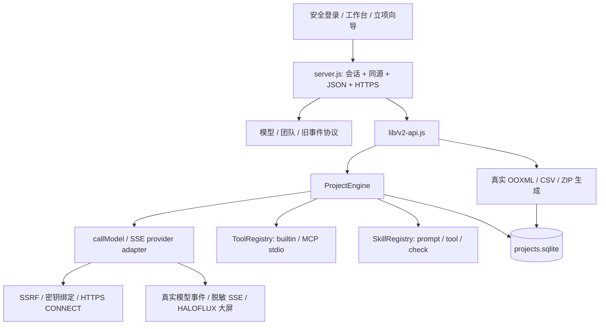

# AIJAVAIS V2 — 实际架构

## 范围

Node 24 单进程应用，无生产 npm 依赖。保留原安全分支的所有模块与事件协议，在管理员认证边界后增加 V2 API。原 `main` 与两个来源分支未经修改。V2 是可运行的有限工作流系统，不是无限自主代理或多租户平台。

## 两层持久化

旧认证/配置保持兼容：`config.json`、`models.json`、`credentials.json`、`teams.json`、`auth.json`、`sessions.json`、`audit.log`、旧 `tasks.json`。凭据不进入公开模型视图；文件权限 0600。V2 不无损恢复旧内存 MessageBus/ArtifactStore，旧 `/api/run` 历史继续按原语义读取。

新增 `projects.sqlite`（schema v2；v1 库启动时先 `VACUUM INTO` 生成 0600 备份再前向迁移）开启 foreign_keys、WAL、synchronous FULL、busy timeout，使用参数化 SQL：

| 表 | 实际用途 |
|---|---|
| schema_migrations | 迁移版本、应用时间和描述 |
| projects | ID、版本、所有者、创建/更新时间及规范化 JSON 文档 |
| runs | 项目 FK、状态、审批/目标/项目快照、时间、累计预算与用量 |
| steps | run+step 联合主键、顺序、角色、输入输出、检查、工具证据 |
| events | 单调 seq、run FK、发生时间和事件 JSON |
| messages | 发送/接收岗位、轮次、交接正文、消费/失败状态 |
| artifacts | run FK、MIME、SHA-256、元数据、真实内容 BLOB |
| usage_ledger | 调用用量、真实/部分/估算/未知来源、价格及保守费用 |
| settings | 版本化 Skills 完整快照；MCP 远程连接、停用列表与访问令牌（令牌从不返回给前端） |
| project_files | （v2）项目资料原始字节、SHA-256、提取出的文字与提取状态；随项目级联删除 |

`projects.sqlite.lock` 阻止第二应用实例打开同一数据目录；死 PID 恢复有独立 recovery 锁。恢复时将未结束运行和步骤标为 interrupted，并把遗留费用预留转为未知账单记录。没有自动重放。在线备份工具用只读 SQLite 连接，避免实例恢复副作用。

## 执行机制

项目创建规范化 name/description/standards/quantification/roles/steps；岗位可增删，职责、边界和标准写入每步 system prompt。步骤可以复用同一模型；角色通信由持久 messages 记录，前序实际输出完整进入后续 prompt，不仅在画面上闪动。

运行前：检查连接通过实际试连、未停用、声明能力满足；所需工具和 Skills 已注册；精确工具权限已批准；非本机免费模型要每次批准及价表。`readyForAutomatedExecution` 等客户端字段不是授权依据。

运行状态主链为 `running → review_required → approved`。质量失败、调用错误、取消分别进入失败/取消状态；重启会进入 interrupted。人工返工需要反馈、新的预算批准并遵守最大轮次；重新执行整个有限步骤序列，保留旧轮次证据。审核通过是人工操作，不把模型“说通过”当正式批准。

每步：交接消息 → 显式工具/Skill before → 预算预留 → 真实模型适配器 → 结算 → 检查/Skill after → 持久成果/消息消费。取消传递 AbortSignal 至网络和工具，等待结算后释放执行标志；执行尚未收尾不允许级联删除。

费用以 USD 用户价格表计算，并非供应商账单核对。用保守输入字节数+输出上限预留 Token 和金额；每步串行预留，限制并发。完整厂商 usage、部分 usage、估算、未知分别记账。可能的历史费用不能被“取消”抹去。

## API 与文件

- `/healthz`：无数据、公开进程健康，可供平台 HTTP 内部探针；不建立会话。
- `/api/v2/health`：管理员可看 schema/activeRuns。
- `/api/v2/projects` 和 `/:id`：创建、列表、读取、版本校验更新、删除。
- `/:id/validate`、`/:id/runs`：检查和启动；`/api/v2/runs/:id` 返回步骤、消息、事件、成果及账本。
- `/api/v2/runs/:id/cancel|review|export`：取消、人工批准/返工、真实二进制生成；artifacts 下载验证 run 归属。
- `/api/v2/tools`、`/discover`、`/call`：列举、受信配置发现、明确授权调用；不接受 HTTP 注册启动命令。
- `/api/v2/skills`：版本化配方持久化；`/intake/plan` 与 `/intake/projects` 使用服务端注册状态重算立项草案。

DOCX/XLSX/PPTX 是实际 ZIP/CRC32/OOXML，不是改后缀文本。Code ZIP 只打包明确提供的文件；不会执行模型生成代码或替用户证明其正确。导出 bytes、MIME、SHA256 和审核状态进入 SQLite，重启可原样下载。

## 安全边界与实际限制

单管理员和只读观看会话，不是企业多用户 RBAC 接线。大屏由既有服务端事件驱动；模拟、外部上报和真实模型事件保持不同来源。V2 项目内容只给管理员，单独 SSE 仅元数据。

严格 DNS 模式固定校验过的 IP；平台代理使用 TLS CONNECT 且保持证书验证、不直连回退。显式 `AIJ_PROXY_DNS=delegate` 仅用于官方或显式白名单公共主机，代理必须负责 DNS/私网阻断；应用不能证明代理实际连接 IP。

MCP 仅 stdio，支持 initialize、tools/list、tools/call。管理员配置进程具有服务账户 OS 权限；`shell:false` 不是沙箱。工具返回内容是未受信数据，不能更改预算/权限。共享 MCP 子进程的取消可能使同服务器并发调用失败，下次重连。尚无 MCP HTTP/OAuth、模型自主工具选择、任意代码安全运行器、专业工程校核或通用附件读取。

## 2026-11 新增模块（Claude Code 接力）

| 模块 | 作用 | 外部程序 |
|---|---|---|
| `lib/file-extract.js` | 上传文件类型核验与文字提取：DOCX/XLSX/PPTX 用自写有界 ZIP 读取（`zlib`、CRC32、压缩比上限）+ 只取文字的 XML 分词（拒绝 DTD）；文本需 UTF-8；PDF 调用 `pdftotext` | poppler（可选） |
| `lib/data-analysis.js` | CSV 解析、确定性统计/分组/排序/筛选、SVG 图表；不计算公式、不执行表达式 | 无 |
| `lib/office-render.js` | Office→PDF、PDF→PNG 与空白页检测；私有临时目录、一次性 LibreOffice 配置、无 shell、超时杀进程组 | LibreOffice、poppler（可选） |
| `lib/mcp-http.js` | MCP Streamable HTTP 客户端，经 `pinnedFetch` 出站（同模型接口 SSRF/TLS 规则），静态令牌 | 无 |
| `lib/capabilities.js` | 能力目录（内置/MCP/Skill/外部服务/未实现）、状态实时计算、立项工具 ID 映射、系统就绪检查 | 检测可选程序 |

内置工具（均需每次运行精确授权）：`docx/xlsx/pptx_generation`、`file_read`、`project_file_read`、`data_analysis`、`chart_generation`、`document_convert`、`document_render`、`builtin:text-stats`、`builtin:json-validate`。

**依赖决策**：继续保持**零 npm 生产依赖**。PDF 文字、Office 转换与渲染使用服务器上的可选系统程序（poppler、LibreOffice），运行时探测；缺失时能力中心显示“需要配置”，相关工具返回 `tool_unavailable`，不伪装成功。Docker 镜像内置 poppler，LibreOffice 体积较大需按需安装。`claude/v2-cloud-snapshot` 中依赖 npm 包的实现未合并，相应能力以零依赖方式重写。

**项目资料进入模型的方式**：运行开始时快照资料文件 ID 与 SHA-256；每步按 `materials.maxChars` 预算把提取文字作为“不可信数据”放入 prompt，截断会明确告知模型并记录实际字数；无法读取的文件会告知模型“存在但无法读取”。步骤可设 `useMaterials:false`。

**MCP 安全边界**：网页只能添加远程 HTTP MCP（不在服务器运行程序）；本机 stdio MCP 只能由管理员写入 `AIJ_MCP_SERVERS_FILE`。停用的服务器工具被移出注册表并拒绝调用。远程服务的地址校验在添加时（语法）和每次请求时（DNS/IP）各做一次。
