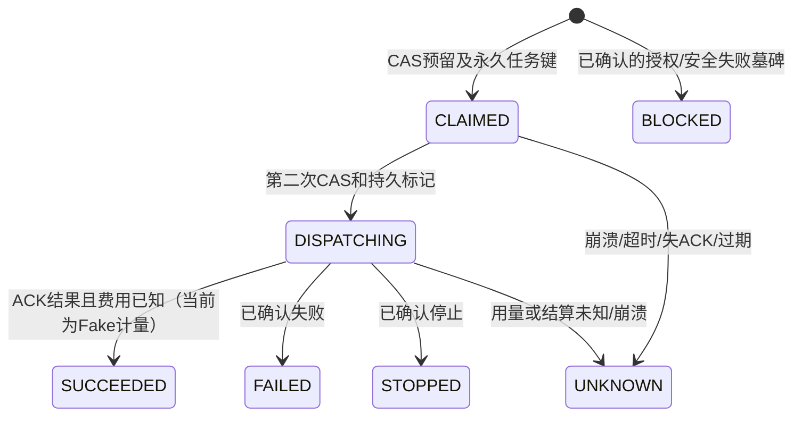

# R46 自动接力控制层（默认OFF）

唯一任务[#30](https://github.com/chaow0879-collab/aijavais/issues/30)，正式决议[#10 R46](https://github.com/chaow0879-collab/aijavais/issues/10#issuecomment-6688764976)。唯一写分支`feat/codex-r46-auto-handoff-control`，精确源为R43冻结SHA **ab3e07979f67924e795426737e26c5c4d84b8501**。不改R43/V1/V2、业务或Claude R44/R45源码，不合main。最终SHA/CI见#30作者交付；代码READY不代表独立审计、真实模型或自动化闭环通过。

产品仍是通用跨普遍/未知行业AI虚拟公司，当前自动接力第一优先；本包只做最后一段控制协调，不扩建永久平台。真实任务/部署/额外费用仍须后续明确授权。

## 当前能力与复用边界

- `reconcile.js`：一次性可重入协调，`bundle()`至多4个**各自已签署**的任务按已验证父结果接力，不生成新权限或任务。默认调用不读backend、不起进程，只返回DISABLED。
- `triggers.js`：GitHub webhook原始字节HMAC、固定repository ID **1446621245**、repo/sender/issue/association/branch/SHA核验；拒绝PR/fork来源。评论正文不当提示词/批准，不保留到日志。tick按600000ms时间桶编号；事件与tick只提供唤醒信号，不能授予执行权。
- `gates.js`：复用原V1 `evaluate()`及V2 `verifyReadiness()`/摘要与验签，要求同R43 SHA独立CodeAudit和QA及精确可验证引用，三个独立签名身份绑定envelope、完整source快照及gate摘要。精确V1 d54b29e11716a01f0812b3e8576982b9f5b9b234，不接受旧REJECT替代。缺失/新BLOCKED/REJECT/错SHA/身份冲突/旧许可/源内容变更都拒绝。
- 原V1要求E4/E5才能通过最终真人门禁。本包仅在**Fake模式**允许“已通过独立代码/QA合同，但唯一缺E4/E5”的模拟基线；不把E4/E5改PASS，不据此批准真实执行。fixture中的原生限额/认证true仅是既有验签接口的合成声明，**不是任何真实账号/限额证据**。
- `state.js`：独立版本1协调记录，复用V2 canonical/digest，保留永久墓碑、任务/派工摘要、owner哈希、保守费用上界、lease、结果及哈希链。原V2 jobs schema无法原子存放envelope/work键/结果，故增加独立文档；没有复制执行引擎或修改原预算/审批机制。
- `github-state.js`：沿用V2 single-parent、force:false的Git ref CAS协议；独立`refs/heads/feat/r46-handoff-state`，单一`handoffs.json`。校验Git blob哈希、JSON唯一规范编码、checksum/状态语义及审计链。未知写入不重试。真实transport构造在编译期拒绝，未创建该ref、未调用真实状态写API。
- `r45-adapter.js`：本构建只允许封闭的Fake适配器，运行原R43**固定Node Stub**，不接收任意命令或回调；实时异常/超时/取消可测，stdout/错误正文不进入公共账本。LiveR45Runner构造即拒绝。

## 状态与失败原子性



Runner前必须两次CAS成功并回读确认owner/状态/摘要/lease；再次检查签名、源及有效期。输入被快照复制，调用方不能在远端等待期间更改已验参数。使用单调耗时叠加入口时间，网络延迟不能让旧lease或过期许可变成启动权。

- 同一task ID改参数拒绝；事件/tick/重复评论/重启不改变idempotency key或dispatch_id。再次审批/换event id不能重派。
- 同一R45工作键（repo/issue/role/phase/source/gate/CLI/固定模板）已记账时，换task ID也不能绕过Runner去重。
- 失claim ACK：不跨Runner seam，已持久CLAIMED由后续只读检查观察；过期转UNKNOWN。失dispatch ACK/部分写/假成功ACK：回读失败，0调用。失结果ACK：报告UNKNOWN，后续可看到已提交结果，但不再执行。
- CLAIMED/DISPATCHING过期后只转UNKNOWN，不抢lease、不删除墓碑、不自动重发；`recover()`可扫描遗留记录，保留全部费用预留。
- 未知费用保持null及保守reservation；失败/未知/停止不自动改0。当前已知0只来自明确标记的Fake meter，不是供应商账单。每日按上界累计，不依赖乐观退款。
- BLOCKED/安全否决/FAILED/UNKNOWN不可通过tick自动复活。WAIT_PARENT/WAIT_ROLE表示**尚未派发**的依赖等待，不是失败重试；只有父SUCCEEDED、费用已知且fixed SHA匹配，子任务自身签名及门禁也通过才可首次启动。
- `halt()`需要受信operator签名绑定`control_operation=HALT`，事务记录HALTED；HALT不授予执行权，故来源出现新BLOCKED/REJECT时仍可停机，不要求模型凭据或新的审计执行许可；普通RECONCILE许可不能用来HALT，HALT许可也不能派工。没有自动unhalt接口。已运行子进程本地Abort即时通知原Stub监督器；跨Runner持久halt的生效延迟受已开始任务硬时限约束，不能声称远端停止可撤销费用。
- 403/429/5xx分类脱敏；只给只读重查退避提示（429=10分钟、5xx=1分钟），本次不循环重试。已可能派发任务不因退避而再起进程。错误code采用固定白名单，错误正文/令牌/任意本地日志路径不落盘。

这是**at-most-once控制**，不是外部模型exactly-once保证：若在DISPATCHING提交后、实际调用前崩溃，会保守UNKNOWN且可能0次执行；宁可人工核对，不重复收费。GitHub强一致依赖受保护FF-only专用ref、唯一可信写身份、禁force/delete；不认证恶意管理员回滚、丢失后端历史或跨内核断电的持久性。不能用临时worker本地文件锁冒充跨Runner账本。

## R45公开契约对接（已按冻结版本核对）

只读核对R45 **0b95251133d47fd7c0b9280d3ddb5287c2628307** 的`contract.js`、policy及固定模板；不合入Runner源码。测试目录中唯一纯公开契约fixture与原Git blob **a79d3fb8952feb94a6c00b2815cc4f13cb880d22**逐字一致，用于形状/digest/dedupe及结果互操作测试，不导入R45 policy/进程/认证实现。

`pilot-contract.js.prepare(frame)`在R46门禁通过后生成**UNSIGNED、E2_E3_FAKE**包装：

| R45字段 | 映射 |
| --- | --- |
| schema | aijavais.pilot.envelope/v1 |
| repo/issue/dispatch_id | 原值保留；不能把R46 issue30偷偷改成R45默认29 |
| role/phase | integrator明确映射developer；audit/qa保持；phase原值 |
| source | branch与R43 source_sha |
| gate | R43 gate_sha、原审核verdict/reviewed_sha/ref（保留ACCEPT_WITH_FOLLOWUP），QA原结果；不伪造自然语言批准 |
| task | codex/claude、readonly、唯一固定readonly-repo-summary、原runtime上限 |
| cost | 请求的原费用上限，默认0不制造正数授权或“免费账号”结论 |
| 时间/trigger | 原到期时间，GitHub event或fallback tick元数据；触发不改变工作键 |
| signature | **不生成**；需要未来被批准的dispatcher broker，不读取私钥/环境凭据、不写公钥配置 |

规范化R45 `aijavais.pilot.outcome/v1`核dispatch/work/digest/source/gate、process.exit、真实/模拟等级、cost及retry，转为内部严格结果；未知费用保持null，真实/E4结果在本Fake构建中拒绝，不能冒充模拟。R45本地log_file不读取/发布；公共log/CI/report引用需由未来可信证据发布者提供，本包仅验证形状，不声称fixture引用是真实远端证据。

**尚未跨包实际联调/不可偷偷解除的差异**：R45默认allowed_issues=[29]，R46=[30]；R45要求正数可执行费用边界，R46默认0；真实dispatcher公钥/官方CLI认证/原生费用约束、R43独立双门禁及未来R45/R46联合候选独立审查尚须核准。不得改写Issue、虚构预算或自签批准来让R45放行。当前未调用R45 CLI或Runner，只做公开契约级测试。

内部R46 envelope为schema=1，字段严格：repo/task_id/source_sha/issue/branch/kind/role/phase/context_digest/limits{runtime_ms,tokens,max_cost}/audit_refs{audit,qa}/expires_at/after/idempotency_key/dispatch_id。idempotency_key=SHA256规范数组[repo,issue,task_id,source_sha,role,phase]，dispatch_id=SHA256['dispatch',key]；所有任务另绑定R45 work_key。approval三签名另绑定该envelope完整摘要、完整源快照、门禁摘要及操作类型。内部outcome严格保存run_id/source/fixed SHA/exit/cost known-null/ref/NEVER及E2_E3_FAKE，拒绝多余权限/执行字段。

任务清单由未来可信发布者提供，每次事件/tick传递同一已签署frame或至多4项bundle；不从Issue正文自动生成任务，不从模型结果生成授权。公共状态只存摘要和回收元数据，不存提示词/私钥/原始日志。当前真实清单发布者、broker和凭据均未部署；库接口不等于云服务已启用。

## 事件、定时及运行命令

```sh
node tools/auto-handoff-r46/cli.js
node tools/auto-handoff-r46/cli.js --fake-demo
node --test tests/auto-handoff-r46/*.test.js
node --test tests/agent-executor/*.test.js tests/agent-scheduler/*.test.js
npm test
```

默认CLI无网络/状态读写/Agent进程；只有显式`--fake-demo`使用checkout里的隔离契约fixture和临时密钥，演示event→单次claim→固定Node Stub→结果→预签子任务，10分钟fake tick重复不再调用。输出actual_agent_launches=0、cost=NOT_VERIFIED。demo需要完整Git checkout（使用测试fixture），不是生产打包入口；没有任意文件/命令参数。

唯一实际workflow `.github/workflows/auto-handoff-r46.yml`仅R46分支push/manual、contents:read、准确github.sha checkout且不保留凭据；没有schedule、issue_comment、workflow_run或Secrets引用。`templates/hosted.yml.disabled`在非工作流目录，只有未来模板，当前CLI即使被复制也默认DISABLED，不能直接作为可启用成品。

真实GitHub webhook处理器/Actions OIDC broker、签名任务发布者、受保护状态ref及真实R45调用都**NOT_ENABLED/NOT_RUN**。仓库默认分支是main，本包未修改main；没有注册云端10分钟cron、daemon或webhook endpoint。纯验证函数支持真实GitHub payload格式，不等于已收到过真实任务事件。

## 验证、历史失败及证据边界

本地控制/契约测试101 total/101 PASS/0 FAIL/0 SKIP；原R43自动化383/383、业务276/276通过。最终准确SHA上的计数、CI run/attempt/所有job、tree/diff见#30交付。当前测试覆盖：

- HMAC/来源身份、fork/PR/错repo/branch/SHA、最新否决/独立账号/签名/过期/伪造审批/未知字段/泄露防护。
- event/tick乱序并发、同ID换参数、换task ID绕work键、单角色互斥、已预批子阶段、所有不可逆失败状态。
- 真实localhost HTTP服务的临时SQLite CAS：四个**不同cwd**进程竞争，只有1次Fake seam调用/1个DISPATCHING记录；服务重启再读永久墓碑。worker在持久marker后SIGKILL及服务在COMMIT后SIGKILL，失ACK后没有另起任务。
- GitHub REST协议用Fake Git DAG验证FF sibling竞争、失ACK/403/404/429/5xx/超时、不初始化/force、blob哈希/重复JSON/损坏状态。**真实GitHub CAS写入未测**；临时SQLite服务是权威共享fixture，不是生产分布式数据库。
- 独立签名HALT、正在运行的本地Abort、clock rollback、真实耗时超过lease、未知费用/上界不释放、半写/假ACK、只读回收。
- 对准确冻结R45纯契约测试序列化、摘要/work键、结果、未知费用及拒绝真实/E4伪装，不将`--version`或Stub当模型。

开发首轮43项仅1通过/42失败，原因是新增契约导出漏REPO，修复后43通过；后续monotonic耗时加入后86项中1项失败，原测试按起始时间+固定TTL猜到期，现改为读取**实际持久lease_until+1**，保留恢复/失ACK断言。跨进程测试按真实Fake调用数与持久marker计数，不把多个只读重复结果的SUCCEEDED当多次执行。失败记录保留于交付说明，不删测试。

原R43运行源码/测试/工作流不变。已验证旧自动化383及完整业务276本地通过；CI如namespace受限内部skip需单独报告，不算PASS。E2/E3均为模拟模型、真实Node/HTTP/SQLite fixture；真实第三方模型/MCP、真实event/cron/R45模型执行、跨主机/断电/恶意后端管理员、生产部署及E4/E5均NOT_RUN。

## 迁移、恢复、回退和下一阶段

本包没有生产数据库迁移，原业务schema仍v4；协调JSON独立schema1，临时SQLite只为测试。未来state ref必须在受控批准下初始化独立orphan commit、根tree只有handoffs.json，配置sole writer/禁force/delete及保留策略；缺ref404本程序拒绝，**不自动创建**。

回退保留所有状态commit、墓碑、未知reservation及测试证据，使用匹配schema的只读诊断和普通追加代码回退；不reset/force push/删历史/复制运行中的DB，也不把UNKNOWN清零或重新运行。坏状态/写ACK未知需人工核对，不能删除文件“修复”。

R46作者READY后冻结，交GPT安排下一共同候选的集中差异审计/QA；R43仍只审原ab3e，不偷合R44/R45/R46或套用旧结论。只有独立门禁、合法官方认证、可核查预算/原生约束、任务权限/停止窗口和明确真实演练授权齐备，才进入一次低风险非生产真实接力；本源构建没有配置/环境开关可绕过编译期禁用。成功首次真实闭环后收口Runner支线，返回普通用户通用AI公司/HALOFLUX产品主线。
